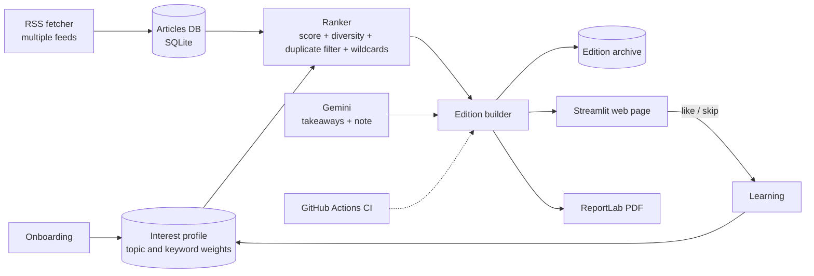

# The Personal Morning Paper

One personal morning paper for every reader. It gathers news from across the web, ranks it for you, learns from what you like and skip, and gives you a web edition plus a newspaper-style PDF.

## The problem
News is scattered across dozens of sites and apps. People jump from link to link and still cannot name three things they learned.

## Features
- **Onboarding:** name, at least 3 topics and free-text interests.
- **Personal web paper:** masthead, lead story, top stories, topic sections, wildcards.
- **Sections ordered by interest:** the topics a reader cares about most appear first, on the web page and in the PDF.
- **"Shown because..." reasons** under every story, so ranking is transparent.
- **Learning:** every Like and Skip updates the reader profile; rebuilding the paper reflects it.
- **Duplicate-story filter:** stories that cover the same event from different sources are detected by headline overlap, so the paper does not repeat itself.
- **Previous papers:** every daily edition is stored and can be reopened.
- **Newspaper PDF:** multi-column layout, images, clickable links, takeaways box.
- **AI takeaways:** Gemini writes "Today's 3 takeaways" and an editor's note, with a safe fallback if the API is unavailable.
- **Wildcards:** a few stories from outside the reader's usual topics, to discover new interests.
- **CI:** GitHub Actions runs a syntax check and tests on every push.

## Architecture


The same edition feeds both the web page and the PDF, so the reader always sees one consistent paper.

## How personalisation works
Each story gets a score:

`score = 2.0 * topic_weight + keyword_score + 1.2 * recency + 0.15 (if image)`

- `topic_weight` starts at 1.5 for chosen topics and 0.2 for others.
- `keyword_score` comes from typed interests and words in liked or skipped titles (clamped to -1.5 to 3.0).
- `recency` decays linearly over 72 hours.
- Diversity caps limit stories per source and per topic.
- Stories the reader skipped, or has already seen in an earlier edition, are excluded.
- Near-duplicate stories (high headline word overlap) are removed.
- A few wildcards are added from topics the reader scores low on.

## How learning works
- Like: topic +0.3, up to 8 title keywords +0.15.
- Skip: topic -0.2, keywords -0.08; skipped stories never return.
- Weights are clamped, and the sidebar chart shows what the paper has learned.

## Run locally
```
pip install -r requirements.txt
python fetcher.py
python -m streamlit run app.py
```
Create a `.env` file (never committed):
```
GEMINI_API_KEY=your_key
GEMINI_MODEL=gemini-3.8-flash
```

## Tests and CI
```
python -m pytest -q
```
Seven tests cover tokenizing, duplicate detection, topic and keyword scoring, and PDF generation. GitHub Actions runs a syntax check and the tests on every push.

## Limitations and future work
- RSS summaries are short; full article text is not fetched.
- Duplicate detection uses headline word overlap, so paraphrased headlines about the same event can still both appear. Embeddings would fix this.
- Learning is rule-based; embeddings could also improve keyword matching.
- Scheduled daily fetch and email delivery are future work.